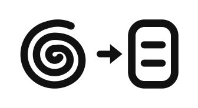

# Granola Sync



A tiny Mac menu-bar app that copies your [Granola](https://granola.ai)
meeting notes into **Apple Notes** (a "Granola" folder in your iCloud
account) — so your meeting notes are searchable in Spotlight, synced to
your iPhone and iPad, and yours to keep.

> **Unofficial.** This project is not affiliated with, endorsed by, or
> supported by Granola. It uses Granola's official public API.

<!-- TODO(steve): add a real screenshot of the open menu here, e.g.
     docs/images/menu-screenshot.png — take it with ⌘⇧4 + space. -->

## What it does

- **One-way sync, safe by design.** Granola → Apple Notes only. The
  app never deletes anything, never touches notes it didn't create
  (its notes carry a `granola-id:` footer), and never overwrites a
  note you've edited.
- **Two sync modes:**
  - **New Notes Only** (default) — each note is copied once and never
    touched again.
  - **New + Updated Notes** — notes you edit in Granola are re-synced.
    An untouched Apple Notes copy is refreshed in place; a copy you've
    edited is left alone and the new version appears beside it as
    "… (updated)". Notes you deleted stay deleted.
- **Runs itself.** Sync on a schedule (hourly / every 4 hours / daily
  at a time you pick), with launchd-style catch-up after sleep, plus
  Launch at Login.
- **No duplicates**, even across reinstalls: a local sync record *and*
  a marker check inside Apple Notes before every create.

## Requirements

- macOS 11+ (Apple Silicon or Intel).
- A Granola account on a **Business or Enterprise plan** — API keys
  are a paid-plan feature (Granola → Settings → API).
- Apple Notes with an iCloud account.

## Install

1. Download `Granola-Sync.zip` from the [Releases](../../releases)
   page and drag **Granola Sync.app** into **Applications**.
2. Open it. If Gatekeeper objects (unsigned interim builds only):
   right-click → Open → Open, or System Settings → Privacy & Security
   → "Open Anyway".
3. Paste your Granola API key when asked, run the first sync, and
   click **Allow** when macOS asks about controlling Notes.

Full walkthrough, menu reference, and uninstall: [INSTALL-APP.md](INSTALL-APP.md).
There's also a [legacy CLI + launchd install](INSTALL.md) if you
prefer no app at all.

## Privacy & security

Your meeting notes are sensitive. This tool is built accordingly:

- **Everything runs locally.** The only network calls are to
  `public-api.granola.ai` — Granola's official API — over HTTPS.
  Nothing is sent anywhere else; there's no telemetry, no analytics.
- **Your API key stays on your Mac**, in `~/.granola-sync/api_key`
  with `600` permissions. It never appears in logs.
- **Auditable.** The sync engine is a single stdlib-only Python file —
  no dependencies to vet. Read [granola_sync.py](granola_sync.py)
  yourself before trusting it with a key.
- **Read-only at Granola's end.** Granola's API offers no write
  access, so the tool couldn't modify or delete your Granola notes
  even if it wanted to.

## Good to know

- Only meetings Granola has **AI-summarized** are exposed by the API —
  a meeting with no summary won't sync (that's the first thing to
  check if a note seems missing).
- Two-way sync (Apple Notes → Granola) isn't possible: the API is
  read-only. If Granola ships write access, it becomes a Sync Option.
- Markdown fidelity is good but not perfect: deeply nested bullets
  flatten to one level (an Apple Notes HTML limitation).

## Development

The engine is dependency-free Python; the app layer uses
[rumps](https://github.com/jaredks/rumps); packaging is PyInstaller.

```bash
python3 granola_sync.py --dry-run      # what would sync, writes nothing
python3 granola_sync.py --inspect     # dump raw API JSON
python3 -m unittest discover -s tests  # pure-logic tests, run anywhere
python3 app/granola_sync_app.py        # run the app from source (pip install rumps)
app/build.sh                           # build the .app (Mac only)
```

Layout: `granola_sync.py` (engine: API client, markdown→Apple Notes
HTML, dedupe, state), `app/` (menu-bar UI, schedule logic, build),
`tests/` (unit tests for all pure logic). Signed/notarized release
builds: [docs/NOTARIZING.md](docs/NOTARIZING.md).

## Support

Best-effort, no promises — this is a side project. Bug reports and PRs
are welcome; feature requests are read but may sit. If the app saves
you time and you'd like to say thanks:

<!-- TODO(steve): add real links (GitHub Sponsors / Ko-fi / Buy Me a
     Coffee) or delete this section. -->
*Donations link coming soon.*

## License

[MIT](LICENSE) © 2026 Steve Pettit
